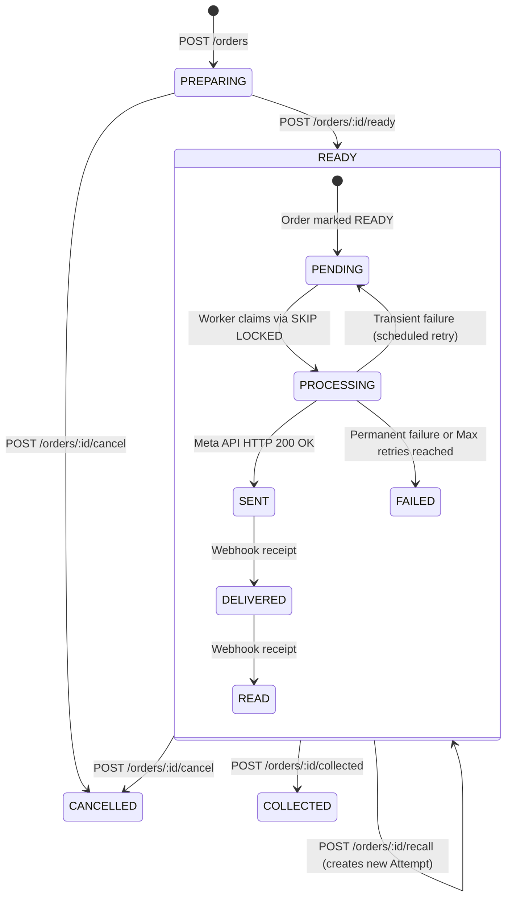

# QuickQueue V1 — Architecture Overview

QuickQueue is a SaaS order-ready notification and status layer designed for self-service restaurants and food-court stalls. When an order is marked `READY`, QuickQueue dispatches an automated WhatsApp notification to the customer and displays real-time delivery status (`Sent`, `Delivered`, `Read`, `Failed`) to restaurant staff.

This document describes the system architecture as **actually implemented** through Phase 18, cross-referencing frozen specifications ([SRS.md](../SRS.md)) with concrete implementation adaptations.

---

## 1. System Topology

```
+-------------------------------------------------------------------------------+
|                               RESTAURANT COUNTER                              |
|                                                                               |
|  +-------------------------------------------------------------------------+  |
|  |             React 19 + TypeScript Single Page Application               |  |
|  |                 (Vite Dev Server: http://localhost:5173)                |  |
|  |  - Auth (Login / Signup / Password Reset)                               |  |
|  |  - WhatsApp Connection Status Panel (Read-only status & Embedded Link)   |  |
|  |  - Order Creation Form (Opaque display token + E.164 phone + Consent)   |  |
|  |  - Active Orders Board (5-second polling via @tanstack/react-query)     |  |
|  +------------------------------------+------------------------------------+  |
+---------------------------------------|---------------------------------------+
                                        | HTTP /api proxy (credentials: include)
                                        v
+-------------------------------------------------------------------------------+
|                              QUICKQUEUE BACKEND                               |
|                     (Node.js + Express: http://localhost:3000)                |
|                                                                               |
|  +-------------------------------------------------------------------------+  |
|  | HTTP Layer (Express Routers)                                            |  |
|  |  - /auth         : Signup, login, logout, password reset               |  |
|  |  - /orders       : Order CRUD, status transitions (READY/COLLECT/CANCEL) |  |
|  |  - /connections  : Multi-tenant WhatsApp Embedded Signup onboarding     |  |
|  |  - /webhook      : Meta WhatsApp Cloud API status & opt-out ingress     |  |
|  |  - /health       : System & database connectivity health check          |  |
|  +------------------------------------+------------------------------------+  |
|                                       |                                       |
|  +------------------------------------+------------------------------------+  |
|  | Background Services                                                     |  |
|  |  - Processor     : FOR UPDATE SKIP LOCKED job claimer (2s polling)      |  |
|  |  - Retry Engine  : Exponential backoff & manual RECALL orchestrator    |  |
|  |  - Scrubber      : 72-hour customer phone scrubbing daemon (1h polling) |  |
|  +------------------------------------+------------------------------------+  |
+---------------------------------------|---------------------------------------+
                                        | Prisma ORM (DATABASE_URL)
                                        v
+-------------------------------------------------------------------------------+
|                              PERSISTENCE LAYER                                |
|                  (PostgreSQL 16 Alpine Docker: port 5433)                     |
|                                                                               |
|  - Restaurants (multi-tenant root, deactivation flag, session versioning)     |
|  - WhatsAppConnections (per-restaurant AES-256-GCM encrypted credentials)    |
|  - Orders (state machine: PREPARING -> READY -> COLLECTED / CANCELLED)        |
|  - NotificationAttempts (delivery attempts, partial unique active index)      |
|  - CustomerOptOuts (scoped opt-outs via inbound STOP messages)                |
|  - PasswordResetTokens (expiring, hashed password recovery tokens)            |
+-------------------------------------------------------------------------------+
```

---

## 2. Frontend Architecture

* **Framework & Tooling:** React 19, TypeScript, Vite.
* **State & Data Layer:** `@tanstack/react-query` managing server state, query invalidation, and automated 5-second polling of active orders (`useOrders.ts`).
* **Styling & Design System:** High-contrast Vanilla CSS (`styles.css`) tailored specifically for busy counter environments.
* **Component Hierarchy:**
  * `App.tsx`: Top-level router switching between authenticated Dashboard, Login, Signup, and Password Reset screens.
  * `Dashboard.tsx`: Primary operational view hosting the WhatsApp status panel, order creation form, search toolbar with clear control, active order metrics pill, and order card list.
  * `OrderCreateForm.tsx`: Input form featuring an accessible country selector (defaulting to India `+91`), duplicate-token detection notice, and default-checked customer consent.
  * `OrderCard.tsx`: Operational card displaying large prominent tokens, duplicate-token badges, relative waiting elapsed time (`30s` ticker update), exact creation time, FR-039 notification status pills, and transition buttons (`Mark Ready`, `Mark Collected`, `Cancel`, `Recall`).
  * `WhatsAppConnectionPanel.tsx`: Collapsible status card displaying honest connection state without exposing internal tokens or credentials.
* **API Client & Dev Proxy:** `frontend/src/api.ts` dispatches requests to `/api/*`, rewritten by Vite dev proxy to `http://localhost:3000/*` with `credentials: 'include'`.

---

## 3. Backend Architecture

* **Framework:** Express 5.2.1 on Node.js 22+, built with TypeScript strict mode.
* **Server Lifecycle (`server.ts`):** Initializes middleware, mounts routers, connects Prisma, and boots the background notification processor loop (`startProcessor()`).
* **Authentication & Session (`auth.ts`, `authRouter.ts`):**
  * Signed HTTP-only cookie-session (`session` / `session.sig`).
  * Passwords hashed using `bcrypt` (12 salt rounds).
  * Monotonic `sessionVersion` counter invalidates all concurrent sessions upon password reset.
  * SHA-256 hashed password reset tokens with 1-hour expiration.
* **Security & Tenant Isolation:**
  * Strict origin validation (`origin.ts`) enforcing `ALLOWED_ORIGINS` across all state-changing requests.
  * Rate limiters (`rateLimit.ts`) guarding authentication and password reset routes.
  * Strict multi-tenant isolation: every query scopes data by `restaurantId` extracted securely from the verified session.

---

## 4. Multi-Tenant WhatsApp Credential Isolation

* **Per-Restaurant WABA Connection:** Rather than sharing a single global platform token, each restaurant possesses its own `WhatsAppConnection` record.
* **AES-256-GCM Encryption (`crypto.ts`):**
  * Sensitive Meta access tokens are encrypted before database persistence using a 256-bit server secret (`WHATSAPP_TOKEN_ENCRYPTION_KEY`).
  * Stored fields: `encryptedAccessToken`, `iv` (12-byte initialization vector), `authTag` (16-byte authentication tag).
  * Decrypted purely in memory within the dispatch worker (`restaurantSender.ts`) at send time. Plaintext tokens never hit logs, database tables, or frontend responses.
* **Embedded Signup Onboarding (`connectionsRouter.ts`):**
  * `POST /connections/signup/initiate`: Generates signed state for the Meta Embedded Signup flow.
  * `POST /connections/signup/complete`: Exchanges auth code for credentials, provisions templates, verifies display name, and persists encrypted credentials.
  * `GET /connections/status`: Read-only status endpoint returning only `connectionStatus` and `connectedAt` (never exposes credentials or provider IDs).

---

## 5. Order & Notification Lifecycle



1. **Order Creation:** Staff enters token and phone. Customer verbal consent is recorded. Order enters `PREPARING`. Duplicate tokens are permitted.
2. **Mark Ready:** Atomic database transaction transitions order to `READY` and inserts a `NotificationAttempt` with status `PENDING` (unless customer opted out or consent was withheld).
3. **Background Claim & Send:** Processor claims job, decrypts credentials, and sends WhatsApp utility template.
4. **Terminal States:** When customer picks up, staff marks `COLLECTED`. If order is discarded or refused, staff marks `CANCELLED`. Terminal orders leave the active polling queue.

---

## 6. Implementation Adaptations vs. Frozen SRS

The implementation preserves the frozen functional requirements while incorporating verified architectural adaptations:

| Area | Frozen SRS Assumption | Actual Implemented Architecture | Rationale |
|---|---|---|---|
| **Database Port** | Assumed standard port `5432` | Pinned to host port `5433` (container port 5432) | Resolves host collision with pre-existing native PostgreSQL installations on Windows development machines. |
| **Backend Port** | Mentioned port `4000` | Standardized on port `3000` | Matches repository `.env.example` and standard local service conventions. |
| **RECALL Limits** | SRS §9.4: "staff may trigger RECALL up to 3 times" | `MAX_RECALL_ATTEMPTS = 4` total attempts (1 initial + up to 3 recalls) | Codified in Phase 10 to provide exact boundary enforcement on total database attempt records. |
| **WhatsApp Sender** | SRS §15 originally contemplated shared platform sender | Per-restaurant `WhatsAppConnection` with AES-256-GCM encryption | Meta WhatsApp Business Platform policies mandate that each merchant operates their own WABA/phone number identity. |
| **Meta Webhook Schema** | Generalized payload assumption | Implemented exact real Meta nested payload (`entry[0].changes[0].value`) | Reverse-engineered from live captured Meta payloads during Phase 13–14 integration. |
| **Restaurant Deactivation** | High-level rule in SRS §9 | Two-phase guard with atomic processing preservation | FR-052/053 enforcement: deactivated restaurants blocked from actions, in-flight processing attempts allowed to finish cleanly, recovered jobs never re-claimed. |
